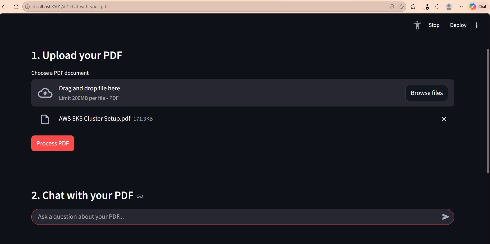

\# PDF AI Assistant — Ask Questions About Your PDF


\## Overview


PDF AI Assistant is a Python application that lets users upload a PDF and ask questions about its content using Retrieval-Augmented Generation (RAG).


It extracts PDF text, divides it into chunks, generates embeddings, retrieves relevant passages, and uses a locally running Ollama language model to generate answers based on the retrieved context.


\## Features


\- Upload and process PDF documents

\- Extract text from PDF pages

\- Split text into overlapping chunks

\- Generate semantic embeddings using Sentence Transformers

\- Retrieve relevant passages using cosine similarity

\- Generate answers using a local Ollama language model

\- Chat interface with conversation history

\- Clear chat functionality

\- Local processing without sending questions to a hosted LLM API


\*\*Note:\*\* The embedding model may download from Hugging Face during its first use. Ollama must be installed and running, with the configured model available locally.


\## Technologies Used


\- Python

\- Streamlit

\- PyPDF

\- Sentence Transformers

\- NumPy

\- scikit-learn

\- Ollama

\- Llama 3.2 (3B)


\## Project Structure


```text

pdf\_ai\_assistant/

├── app.py

├── pdf\_processor.py

├── rag\_engine.py

├── chunker.py

├── embeddings.py

├── create\_vectorstore.py

├── search.py

├── rag.py

├── llm\_test.py

├── requirements.txt

├── README.md

├── documents/       # Local PDFs; excluded from Git

└── vectorstore/     # Generated data; excluded from Git

```


\## Setup Instructions


\### 1. Clone the repository


```bash

git clone YOUR\_GITHUB\_REPOSITORY\_URL

cd pdf\_ai\_assistant

```


\### 2. Create and activate a virtual environment


On Windows:


```bash

python -m venv .venv

.venv\\Scripts\\activate

```


\### 3. Install dependencies


```bash

python -m pip install -r requirements.txt

```


\### 4. Install and prepare Ollama


Install Ollama, then download the model used by the application:


```bash

ollama pull llama3.2:3b

```


Make sure Ollama is running locally.


\### 5. Run the application


```bash

streamlit run app.py

```


Open the local URL shown in your terminal.


\## How It Works


1\. The user uploads a PDF.

2\. The application extracts its text.

3\. The text is divided into overlapping chunks.

4\. Sentence Transformers converts the chunks into numerical embeddings.

5\. A question is embedded using the same model.

6\. Cosine similarity identifies relevant chunks.

7\. Ollama generates an answer using the retrieved context.


\## Limitations


\- Scanned PDFs may require OCR.

\- Answers depend on the quality of the extracted text and retrieved passages.

\- The local language model may occasionally produce unsupported information.

\- Processing speed depends on available memory and hardware.


## Application Screenshot




\## Future Improvements


\- Display source passages and PDF page references

\- Add retrieval confidence thresholds

\- Support multiple documents

\- Add OCR for scanned PDFs

\- Improve answer-grounding checks

\- Deploy a demo for portfolio use


\## Author


Developed as a hands-on Python and AI portfolio project to demonstrate PDF processing, semantic search, RAG, and local LLM integration.

